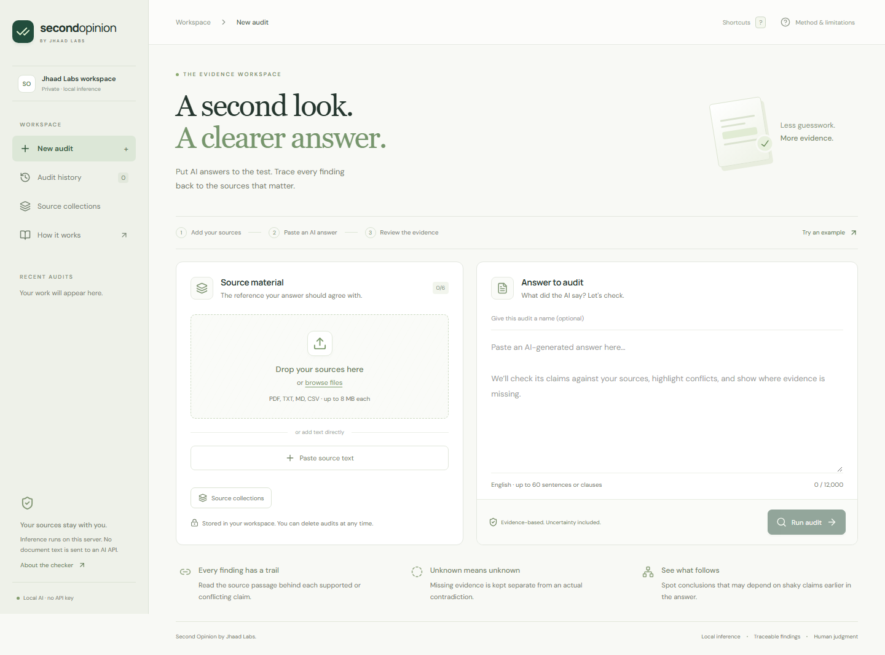

# Second Opinion by Jhaad Labs

**A Jhaad Labs product. Evidence before confidence.** Audit an AI-generated answer against your own documents, inspect the source passages behind each finding, and revise the answer with a visible evidence trail.

Built for the CRCE **Second Opinion: Audit Another AI** problem statement. This is a working, single-workspace research prototype with real local model inference, an Express API, persistent SQLite storage, and a React interface. There are no canned audit responses and no paid AI API key is required.

[](https://github.com/jhaadhelp/Jhaadpay_college_round/actions/workflows/ci.yml)



[View the evidence-review screen](docs/images/evidence-report.png)

## Run on GitHub

[Open in GitHub Codespaces](https://codespaces.new/jhaadhelp/Jhaadpay_college_round)

1. Create a Codespace from this repository (or choose **Code → Codespaces → Create codespace on main**).
2. Wait for the setup to install dependencies, build the interface, and download the model. The first setup needs an internet connection.
3. Open **port 3001** in the Ports panel. Keep its visibility **Private**. The app starts automatically.
4. Click **Try an example**, then **Run audit**. The results are computed on your Codespace's CPU.

If the app is stopped, run `npm start` in the terminal. Codespaces use is subject to your GitHub account's quota and billing. The repository itself is private; this project does not make it public or create a paid deployment. GitHub Pages cannot run this Node/SQLite backend.

## Run locally

Requires **Node.js 24 LTS**, npm, and an internet connection for installation and the initial model download. A modern desktop browser is recommended.

```sh
git clone https://github.com/jhaadhelp/Jhaadpay_college_round.git
cd Jhaadpay_college_round
npm ci
npm run build
npm run model:download
npm start
```

Open **http://127.0.0.1:3001**. Your existing GitHub access is needed to clone this private repository. For interface development, use `npm run dev` and open http://127.0.0.1:5173.

## What works

| Capability | Implementation |
|---|---|
| Source ingestion | PDF, TXT, Markdown, CSV, drag-and-drop, and pasted text. PDF page references are retained. |
| Real AI comparison | Quantized DeBERTa natural-language inference model runs on the server CPU. |
| Claim verdicts | Supported, contradicted, insufficient evidence, or ambiguous; never a forced binary decision. |
| Evidence trail | Verbatim retrieved passages, source names, page/line locations, and inspectable model signals. |
| Numerical checks | Explicit `from A to B, C%` claims checked with a deterministic formula. Mixed units and unsupported patterns abstain. |
| Internal consistency | Up to 12 related answer pairs checked for possible contradictions. |
| Reasoning map | Conclusion markers connect possible dependencies; uncertain premises flag downstream review. |
| Review flags | A bounded language heuristic flags potentially consequential instructions for human review. |
| Revisions | Edit an existing answer, apply reviewable source-based suggestions, and run a new linked audit. |
| Comparison | Side-by-side original/revised claims with changed verdicts, added claims, removed claims, and source-change disclosure. |
| Human review | Persistent notes and reviewer verdicts alongside the unchanged machine findings. |
| Source search | Search and highlight literal words or phrases inside extracted documents. |
| Source collections | Save, reuse, and delete sets of source documents. |
| Audit history | Search, reopen, export, and delete saved audits. |
| Exports | Markdown, complete JSON, and a print layout for **Print / PDF → Save as PDF**. |
| Shortcuts | Ctrl/Cmd+Enter to run, J/K to move through claims, ? for help, Escape to dismiss dialogs. |
| Operational controls | Job progress, cancellation, bounded queue, input limits, explicit model errors, restart recovery. |
| Private workspace | Localhost by default, optional password login, same-origin write checks, no document text sent to an AI API. |

## Three-minute demo

1. **Try an example → Run audit.** The Northstar pilot example contains accurate statements, numerical errors, contradicted population claims, unsupported predictions, and a questionable conclusion.
2. Select **“100 to 120, a 30% increase.”** Inspect the calculation and the original passage.
3. Select the long-term retention claim and compare it with the source. Select the market-leader prediction to see missing evidence handled separately.
4. Open **Reasoning map** to inspect the proposed link to a conclusion. Links are deliberately labelled as suggestions.
5. Add a **reviewer note** and a manual verdict; the AI finding remains unchanged.
6. Use **Edit & re-audit**, change 30% to 20%, rerun, and open **Compare**.
7. Save the source set as a collection and export the finished report using **Print / PDF**.

See [the submission guide](docs/SUBMISSION.md) for the problem-statement mapping and [architecture](docs/ARCHITECTURE.md) for the implementation.

## Validation

```sh
npm test                         # unit and API tests, no model download
npm run build                    # production UI build
npm run test:model               # real local model, labelled development cases
npm run test:offline             # fresh-process inference with all fetches blocked (after model download)
npx playwright install chromium # browser runtime, once
npm run test:browser             # real-model end-to-end workflow and mobile checks
npm audit --audit-level=high
```

The checked-in [evaluation results](evaluation/results.json) disclose every case and miss. The initial 20-case **authored development set** produced 19 matching labels, with 8/9 expected contradictions detected and no false contradiction labels in that small set. This is **not a held-out benchmark, a calibration study, or a general accuracy claim**. The causal-leap example is the disclosed miss: it returned insufficient evidence instead of the expected contradiction. Thresholds are fixed in `server/audit.js`; no case IDs are used by the engine.

The GitHub workflow runs unit/API tests, a production build, dependency auditing, the real-model evaluation, and browser tests. It saves reports and screenshots as workflow artifacts.

## Important boundaries

- **Source-grounded, not omniscient.** A supported claim agrees with the supplied material. The material itself can be wrong, outdated, or incomplete.
- **English-focused.** Claims are sentence/semicolon units. Compound assertions may need manual splitting.
- **Bounded retrieval.** BM25 selects up to four passages per claim and may miss paraphrases or distant context. Long token pairs abstain instead of silently truncating.
- **No fabricated confidence.** Model scores are uncalibrated inference signals. They are not probabilities that a claim is true.
- **PDF text only.** Scanned pages require OCR elsewhere. Complex tables, multi-column layouts, and images need extraction review. CSV is treated as text rather than a spreadsheet calculation engine.
- **Heuristic reasoning/safety aids.** Dependency arrows are not proven causal links. Safety flags are not expert judgments. The numerical checker covers a narrow documented pattern.
- **Single shared workspace.** A password protects the whole instance; this is not a multi-tenant service. All people with workspace access can see its audits and source collections.
- **Persistent, not encrypted-at-rest storage.** Audit/source data is in `data/audits.sqlite`; model files are under `.cache/models`. These and `.env` are excluded from Git. Deleting an audit removes its active records, not copies in backups or separately saved collections. Deleting a collection does not remove source snapshots already retained inside audits.

## Configuration and deployment

Copy `.env.example` to `.env` if you need custom settings. Runtime data and secrets must never be committed.

| Variable | Default | Purpose |
|---|---|---|
| `PORT` | `3001` | API and production interface port. |
| `HOST` | `127.0.0.1` | Local binding; a non-loopback binding requires `APP_PASSWORD`. |
| `DATA_DIR` | `./data` | SQLite location. |
| `MODEL_CACHE_DIR` | `./.cache/models` | Downloaded model cache. |
| `APP_PASSWORD` | unset | Optional single-workspace login; required for direct network exposure. |
| `SECURE_COOKIE` | `0` | Set `1` when using HTTPS. |
| `PUBLIC_ORIGIN` | unset | Exact allowed external origin behind your reverse proxy. Private Codespaces origins are detected automatically. |

Optional container packaging is included. With a strong `APP_PASSWORD` configured in your shell:

```sh
docker build -t second-opinion .
docker run --rm -p 127.0.0.1:3001:3001 -e APP_PASSWORD -v second-opinion-data:/app/data -v second-opinion-models:/app/.cache/models second-opinion
```

No external hosting account is required for local use. Container instructions are provided as a packaging option; see the verification notes for environments actually tested.

## Model and dependency provenance

The inference model is [Xenova/nli-deberta-v3-xsmall](https://huggingface.co/Xenova/nli-deberta-v3-xsmall), an ONNX conversion of [cross-encoder/nli-deberta-v3-xsmall](https://huggingface.co/cross-encoder/nli-deberta-v3-xsmall). Its revision is pinned to `2a4f614a701367a02d51389039afc998faeda637`. Weights are downloaded into a local cache rather than committed to GitHub. Consult the linked model cards for their terms and training details. Direct JavaScript dependencies are version-pinned, with transitive versions recorded in `package-lock.json`.
