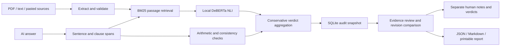

# Architecture

**Second Opinion by Jhaad Labs**

## Process model

Express serves the production Vite build and `/api` routes from one origin. React handles drafts, review, comparisons, and exports. SQLite stores audit inputs, results, progress, source collections, and human reviews. Node 24's built-in SQLite module avoids a separate database server. Development mode uses a Vite proxy.

Audits enter a bounded in-process queue and run serially, so one model instance is reused. Progress is polled every 1.5 seconds. Cancellation is cooperative between comparisons; a currently executing inference finishes first. On restart, unfinished audits are marked failed and their original inputs remain available. The queue is not a distributed job service.

## Verification method

1. Preserve answer offsets while splitting English sentences, newlines, and semicolons. This localizes findings to source answer spans without generating replacement claims.
2. Extract local source context into bounded passages with source/page/line metadata.
3. Rank passages using BM25; inspect at most four candidates per claim and reject low lexical overlap.
4. Treat a whole-sentence normalized exact match as direct support. A substring match inside a negation does not qualify.
5. Otherwise run a pinned, quantized DeBERTa NLI model on the passage/claim pair. Scores are normalized model logits, not calibrated truth probabilities.
6. Apply fixed thresholds: entailment 0.86, contradiction 0.88; supporting and contradicting evidence together produce ambiguity. Borderline evidence abstains. A missing match produces insufficient evidence.
7. Check narrowly defined percentage changes, a bounded set of related answer pairs, and explicit conclusion markers.
8. Save the complete evidence trail, model revision, thresholds, and limitations.

Arithmetic results are shown with their formula. Source replacements are verbatim excerpts, not generated authoritative answers. Users review them before rerunning the checker. A contradiction between sources is not automatically resolved by source order.

## Six review features

- Reviews use `(audit_id, claim_id)` keys and preserve original machine findings. Re-saving replaces the current human note; this prototype does not retain a full edit history of reviewer notes.
- A revised audit stores `parentId`. Comparison prioritizes unchanged claims before pairing edited claims by word-set overlap. Added/removed claims remain explicit; matching is heuristic. Source changes are disclosed.
- Source search is literal, case-insensitive text search with escaped React rendering and highlighted matches.
- Collections store independent source snapshots. Loading one replaces the draft's references. Existing audit evidence remains immutable.
- The print-only report includes all claims, evidence, notes, source names, and method limitations, independent of the selected screen tab.
- Shortcuts avoid ordinary text fields and open dialogs. Ctrl/Cmd+Enter runs a ready draft; J/K moves within the current claim filter.

## API

| Method / route | Purpose |
|---|---|
| `GET /api/session` | Check workspace login. |
| `POST /api/login`, `POST /api/logout` | Password sessions when enabled. |
| `GET /api/health` | Model state and input limits. |
| `POST /api/extract` | One bounded multipart upload; returns extracted source data. |
| `GET /api/audits`, `POST /api/audits` | List saved work / enqueue an audit. |
| `GET /api/audits/:id`, `DELETE /api/audits/:id` | Inspect / delete a finished audit. |
| `POST /api/audits/:id/cancel` | Cancel queued or running work. |
| `PUT /api/audits/:id/reviews/:claimId` | Save a human verdict and note. |
| `GET /api/collections`, `POST /api/collections` | List / save source collections. |
| `DELETE /api/collections/:id` | Remove a saved collection. |

## Limits and trust boundaries

Six sources; 60,000 characters per source; 180,000 combined source characters; 12,000 answer characters; 60 sentence/clause units; 8 MB upload size; 80 PDF pages; 50 saved collections. History lists the latest 100 audits. There is no URL-fetch endpoint. Source text is data for classification and is never executed as code or followed as instructions.

Production defaults to loopback. Direct external binding requires a password. Password sessions are HttpOnly, SameSite=Strict, expire after 12 hours, and reset on restart. Login attempts are rate limited per socket address. All routes share one workspace access boundary. Use HTTPS and Secure cookies when placing an instance behind a reverse proxy. Do not treat this as audited multi-tenant infrastructure.

## Files

- `server/audit.js`: evidence aggregation and auditing.
- `server/model.js`: pinned NLI model and local loading.
- `server/text.js`: validation, spans, passages, retrieval.
- `server/extract.js`: bounded file extraction.
- `server/app.js`, `server/db.js`: API, queue, persistence.
- `src/main.jsx`, `src/extras.jsx`: interface and review tools.
- `src/comparison.js`: revision pairing.
- `evaluation/`: labelled development set and disclosed results.
- `tests/`: unit, API, and actual-model browser workflows.
